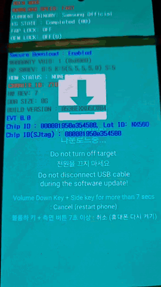

# SVE-2026-3546 - Unsigned code loading for S-LK

This PoC uses it to fuse Secure Boot KEY2 and flash re-signed bootloader files on s5e8825 platform (no others for now, i'm lazy).

## Demo



## Requirements

- Python 3
- `clang`
- `aarch64-linux-gnu` binutils
- libusb access to the phone

Install the Python packages:

```sh
python3 -m pip install -r requirements.txt
```

Build the Android resigner:

```sh
cargo build --release --manifest-path android-resigner/Cargo.toml
```

Android signer commands: [android-resigner/README.md](android-resigner/README.md).

## 1. Sign BL and PIT

```sh
./sign_bl.py BL.tar.md5 device.pit
```

Outputs:

```text
BL_RESIGNED.tar.md5
device_RESIGNED.pit
```

## 2. Find offsets. Only for s5e8825. For other platforms you're on your own.

```sh
./resolve.py BL_RESIGNED.tar.md5
```

## 3. Build the loader

```sh
./build_loader.sh BL_RESIGNED.tar.md5 device_RESIGNED.pit
```

Outputs:

```text
loader.bin
loader.elf
loader/bundle.bin
```

## 4. Run

```sh
./flash_and_fuse.py
```

## Disclaimer

This repo is for research purposes. No one else than you is responsible for what you do to your phone, especially if you're modifying it with LLMs.
